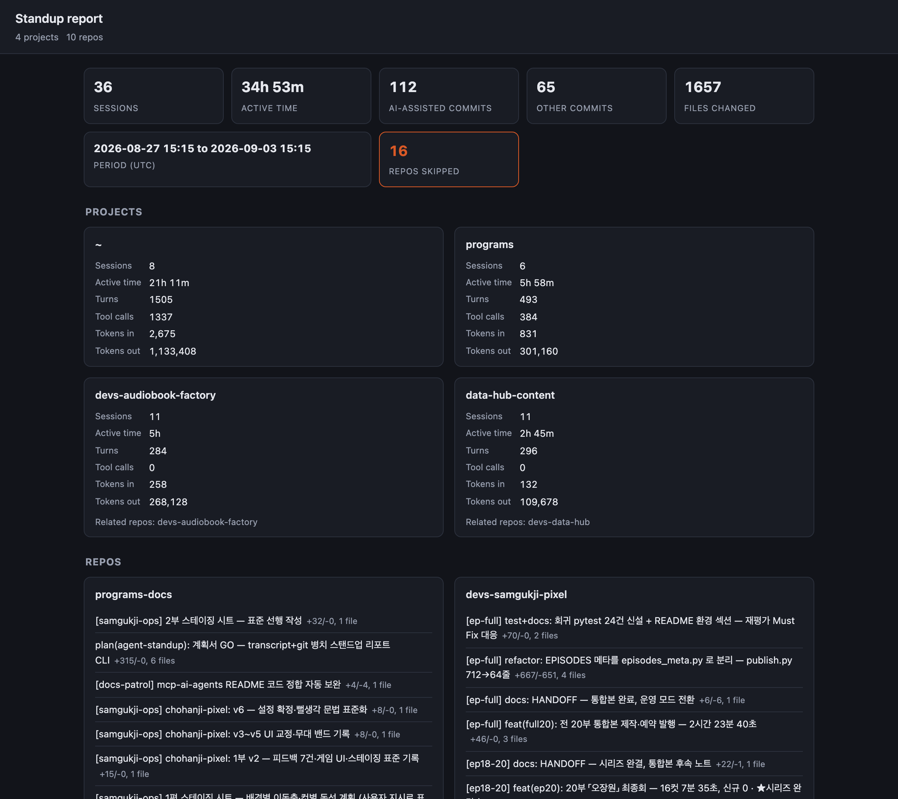

# agent-standup

[](https://github.com/oh-namgyu/agent-standup/actions/workflows/ci.yml)
[](LICENSE)

> **한글 요약**
>
> - `~/.claude/projects` 의 세션 기록과 로컬 `git log` 를 한 기간 동안 나란히 모아 **붙여넣기용 스탠드업 리포트**를 만드는 CLI 입니다.
> - 설치할 것이 없습니다. Python 3.9 이상이면 되고 **외부 의존성이 0개** (표준 라이브러리 + 시스템 `git` 바이너리)입니다.
> - 바로 실행: `python3 -m agent_standup --since=7d` → 최근 7일 리포트가 Markdown 으로 표준출력에 나옵니다.
> - 커밋의 `Co-Authored-By: Claude` 트레일러로 **AI-assisted 커밋과 그 외 커밋을 구분**해 보여줍니다 (인과관계 주장이 아니라 병치입니다 — 아래 "How it works" 참고).
> - 결과물에 **대화 내용은 들어가지 않습니다.** 세션 활동 수치와, AI-assisted 로 분류된 커밋의 제목·증감량만 담깁니다.
> - 계정 이름과 홈 경로는 **기본으로 가려지고**, 출력 직전 한 번 더 스캔해 놓친 것이 있으면 **아예 출력하지 않는** 방어선이 있습니다.
> - `--html` 로 자바스크립트 없는 단일 HTML 페이지도 만들 수 있습니다.

Turn Claude Code session activity and your git commit history into one paste-ready standup report.

## What it is

Claude Code records every session as a JSON Lines file under `~/.claude/projects`. Separately, your
projects' git history already records who committed what and when. agent-standup reads both for one
time window and lays them side by side: per-project session activity (sessions, active time, turns,
tool calls, tokens) and per-repo commit history split into AI-assisted and other commits, based on
each commit's `Co-Authored-By` trailer.



## Why

Writing a standup update means reconstructing "what did I actually do" from two places that don't
talk to each other: a pile of Claude Code transcripts and `git log`. agent-standup does the
reconstruction and gives you one report — Markdown by default, so it pastes straight into a chat or
a ticket — without uploading anything anywhere.

## Quickstart

Requires **Python 3.9+** and a **`git` binary** on `PATH` (for the git axis; the tool still works
without it, just without commit data). There are **no Python dependencies** — standard library only.

```sh
git clone https://github.com/oh-namgyu/agent-standup.git
cd agent-standup
python3 -m agent_standup --since=7d
```

That scans the last 7 days and prints a Markdown report to stdout.

```sh
python3 -m agent_standup --since=14d -o standup.md   # write to a file instead of stdout
python3 -m agent_standup --html -o standup.html      # a self-contained HTML page instead
python3 -m agent_standup --since=2026-01-01 --until=2026-01-08
python3 -m agent_standup --no-git                    # transcript activity only, skip git
```

## CLI reference

| Flag | Default | Description |
| --- | --- | --- |
| `--since WHEN` | `7d` | Start of the period: relative (`7d`, `14 days`) or an absolute date/date-time. |
| `--until WHEN` | now | End of the period, exclusive. Same relative/absolute forms as `--since`. |
| `-o`, `--output PATH` | stdout | Write the report to `PATH` instead of stdout (atomic write). |
| `--html` | off | Render a self-contained HTML page instead of Markdown. Without `-o`, writes `standup.html` in the current directory. |
| `--project NAME` | all projects | Limit to one Claude Code project directory. Names begin with a dash, so use the `--project=NAME` form. |
| `--utc` | local time | Interpret relative and date-only periods in UTC instead of the local time zone. |
| `--no-redact` | off | Show raw paths and commit subjects, and skip the fail-closed self-check. |
| `--no-git` | off | Skip the git axis entirely — transcript activity only. |
| `--version` | — | Print the version and exit. |
| `-h`, `--help` | — | Show usage and exit. |

Transcripts are read from `~/.claude/projects` (or `CLAUDE_CONFIG_DIR` if set). `stdout` carries
exactly the report (no `-o`) or, with `-o`, the path that was written — so `open "$(python3 -m
agent_standup --html -o standup.html)"` opens the freshly written page. Everything else (scan
counts, warnings, the final summary line) goes to `stderr`.

Exit codes: `0` success (warnings possible), `1` nothing to report in the selected window (or the
self-check refused to emit), `2` a usage error (bad `--since`/`--until`, or a filesystem error
writing the output).

## How it works

**This is a juxtaposition, not an attribution claim.** The report never says "this commit came from
that session." It shows two independent views of the same time window — what your Claude Code
sessions were doing, and what landed in git — next to each other, and leaves the connection to you.
A project's "related repos" line is the one link it does draw, and only when that project's own
recorded working directory resolves to a git repository.

- **AI-assisted vs. other.** A commit is AI-assisted if its `Co-Authored-By` trailer contains
  "claude" (case-insensitive) — the convention `git commit` and Claude Code both produce when a
  commit is auto-attributed. A mention of "Co-Authored-By: Claude" as plain prose in the commit body
  does not count; only a real trailer, as git's own trailer parser recognizes it, does. Reading the
  trailer with `%(trailers:key=...)` needs **git 2.22 or newer**; on an older git the tool still
  collects commits but leaves all of them unclassified and prints a warning.
- **Active time** sums the gaps between consecutive events inside a session, counting only gaps of
  15 minutes or less — a longer gap is treated as the session going idle and contributes nothing.
  Overlapping sessions (two Claude Code windows open at once) both count in full, so active time
  measures AI-session time, not wall-clock human time.
- **The period** is one absolute `[start, until)` instant pair applied identically to both axes:
  transcript events and git's own commit timestamp (`%ct`). git's `--since`/`--until` are only a
  prefilter; the tool's own timestamp comparison is authoritative at both boundaries.

## Privacy & redaction

**No transcript message content ever appears in a report.** It holds only counts, dates, tool
names, prettified project/repo labels, and the subject line of commits classified as AI-assisted —
see [SECURITY.md](SECURITY.md) for what that subject line can and cannot contain.

Redaction is **on by default**:

- Project and repo labels keep only their last couple of path segments, with the home prefix
  stripped: `/Users/alice/code/app` becomes `code-app`, and a home directory itself becomes `~`.
- Labels and commit subjects then pass through a redactor that masks account names, email
  addresses, API keys and tokens, and home paths.
- **Fail-closed backstop:** right before anything is printed or written, the fully rendered report
  is scanned once more for the account name, a raw home-path prefix, or any still-unmasked secret
  pattern. If anything turns up, the tool writes nothing and exits with an error instead of emitting
  a partially-redacted report.

> Redaction — including the backstop — is pattern-based, not a guarantee. Review a report before
> sharing it. `--no-redact` disables all of it and shows raw paths, account name, and subjects.

## Related tools

- [cc-replay](https://github.com/oh-namgyu/cc-replay) — replays a single session transcript as a
  readable HTML timeline. agent-standup vendors its transcript parser and redactor.
- [cc-stats](https://github.com/oh-namgyu/cc-stats) — turns every Claude Code session into one HTML
  analytics dashboard. agent-standup's scanner and per-session aggregation rules follow the same
  contract so the two tools agree on what a "session" and a "turn" are.

## Development

No build step and no dependencies. Run the tests with the standard library:

```sh
python3 -m unittest discover -s tests -v
```

105 tests cover scanning, session summarization, git discovery and log parsing against real
temporary repositories, report rendering (Markdown and HTML, including hostile-input fixtures), and
the CLI. They run on Python 3.9 through 3.12 and use synthetic fixtures and temporary git repos
only — no real transcript and no real git history is ever read by a test.

`agent_standup/_vendor/` holds unmodified copies of `parser.py` and `redactor.py` from
[cc-replay](https://github.com/oh-namgyu/cc-replay) at commit `04618de`. Do not edit them here: fix
upstream and re-sync so the copies stay diffable against their source.

## License

MIT — see [LICENSE](LICENSE). Security policy: [SECURITY.md](SECURITY.md).
